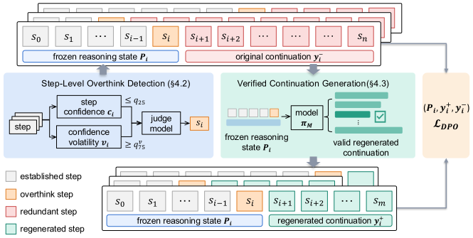

Think Less, Locally: Local Preference Learning for Reasoning Compression
========
* This repository is an official implementation of the paper [Think Less, Locally: Local Preference Learning for Reasoning Compression](http://arxiv.org/abs/2611.04814).

<p align="center">
&nbsp;&nbsp;<a href="http://arxiv.org/abs/2611.04814"></a>
&nbsp;&nbsp;<a href="https://huggingface.co/MuyaoYuan/LoCo-7B"></a>
</p>

## Introduction

**TL;DR:** LoCo compresses a reasoning model's chain of thought using its own traces. It locally detects overthinking states, pairs them with shorter verified continuations regenerated from the same states, and applies DPO to these state conditioned pairs to teach the model when to stop thinking.

<p align="center">

</p>

**Abstract.** Large reasoning models achieve strong performance on challenging tasks, but their long chain-of-thought often incurs substantial inference costs by continuing to deliberate after sufficient information has been obtained. Existing reasoning compression methods primarily operate on reasoning trajectories, paying less attention to the local decision of whether further reasoning is necessary given the current state. We propose LoCo, a local preference learning method for reasoning compression. LoCo detects candidate overthinking states from the model's own traces, freezes the corresponding reasoning prefixes, regenerates shorter verified continuations from the same states, and trains on the resulting state-conditioned preference pairs with DPO. This formulation teaches the model when to continue reasoning and when to conclude, rather than simply encouraging shorter trajectories overall. We construct training data entirely from self-generated mathematical traces and evaluate LoCo on five mathematical and three code generation benchmarks. LoCo reduces completion length by 41.7\%--45.4\% on mathematics and 23.4\%--36.3\% on code, while maintaining or improving accuracy and achieving the best AUC across all code benchmarks. LoCo consistently improves the accuracy-efficiency trade-off on mathematics and transfers effectively to code generation despite math-only training, demonstrating the cross-domain generality of local preference learning for reasoning compression.

## Installation

CUDA 12.8 and Python 3.12 are recommended. The code was developed on NVIDIA H20 GPUs. Key dependencies include:

```bash
pip install torch==2.11.0 --index-url https://download.pytorch.org/whl/cu128
pip install vllm==0.23.0 trl==0.29.1 transformers==4.57.6 peft==0.19.1 accelerate datasets deepspeed pyyaml
pip install flash-attn==2.8.3.post1 --no-build-isolation
pip install math-verify tqdm ijson
```

## Checkpoints
The model checkpoints for **LoCo** are available for download on Hugging Face: [MuyaoYuan/LoCo-7B](https://huggingface.co/MuyaoYuan/LoCo-7B).

```bash
hf download MuyaoYuan/LoCo-7B --local-dir model/LoCo-7B
```

## Data Construction

Two models are required. Download them directly to the corresponding paths:

```bash
hf download deepseek-ai/DeepSeek-R1-Distill-Qwen-7B --local-dir model/DeepSeek-R1-Distill-Qwen-7B

hf download Qwen/Qwen3-30B-A3B-Instruct-2507 --local-dir model/Qwen3-30B-A3B-Instruct-2507
```

* `DeepSeek-R1-Distill-Qwen-7B`: base model and training target
* `Qwen3-30B-A3B-Instruct-2507`: judge model

The preference data is constructed from the model's own traces over the math14k training pool (`data/math14k/`, 14,027 questions) through six steps under `construction/`:

```bash
bash construction/1_rollout/configs/run_3x.sh          # generate 3 rollouts per question
bash construction/2_filter/configs/run_filter.sh       # keep the shortest correct rollout
bash construction/3_detection/configs/run_detection.sh # detect potential overthinking steps
bash construction/4_rejudge/configs/run_rejudge.sh     # rejudge flagged steps
bash construction/5_regenerate/configs/run_regenerate.sh # regenerate 8 continuations per state
bash construction/6_build_dpo/configs/run_build_dpo.sh  # build DPO pairs
```

The final preference pairs are saved to `out/6_build_dpo/dpo.jsonl`. Rollout and regeneration support multi GPU execution via `GPUS=`.

## Train

Train on the preference data with:

```bash
bash script/train/run.sh  # 4 GPUs, 2 epochs, DeepSpeed ZeRO-2
```

Override defaults with `GPUS`, `EPOCHS`, `EFF_BS`, and `DATA`. Checkpoints are saved to `out/train/`.

## Evaluate

For a trained model, merge the LoRA adapter into the base model and run evaluation:

```bash
python train/merge.py \
    --base-model model/DeepSeek-R1-Distill-Qwen-7B \
    --adapter out/train/checkpoint-<N> \
    --output out/merge/trained_model

MODEL=out/merge/trained_model bash script/eval/run.sh math500
```

Replace `<N>` with the highest-numbered checkpoint under `out/train/`.

Evaluate one or multiple benchmarks with:

```bash
bash script/eval/run.sh math500
bash script/eval/run.sh aime24 aime25
```
Results are saved to `out/eval/`, with accuracy, average completion length, and per-sample responses. Answers are extracted from the final `\boxed{}` and graded by symbolic equivalence using [`math_verify`](https://github.com/huggingface/Math-Verify).

The released `model/LoCo-7B` is the default evaluation target:

```bash
bash script/eval/run.sh math500
```